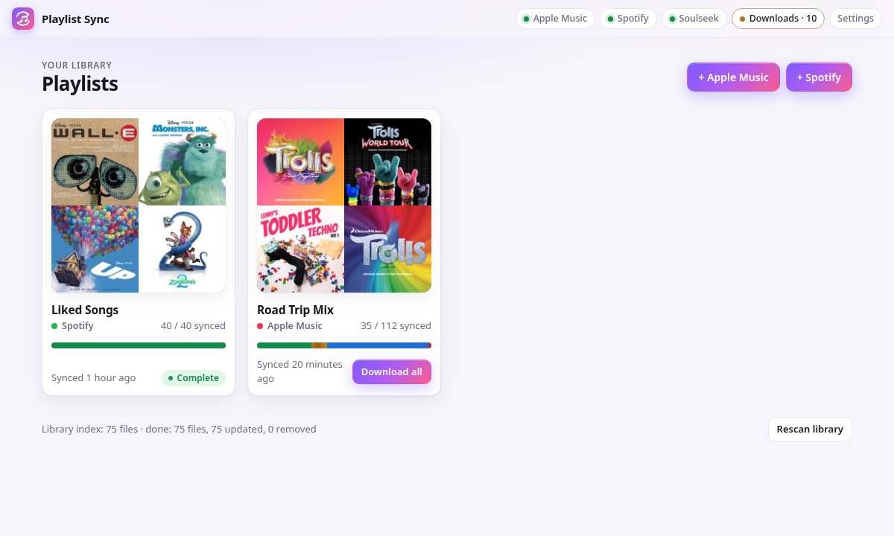
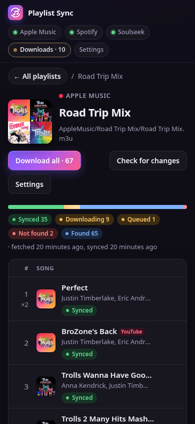
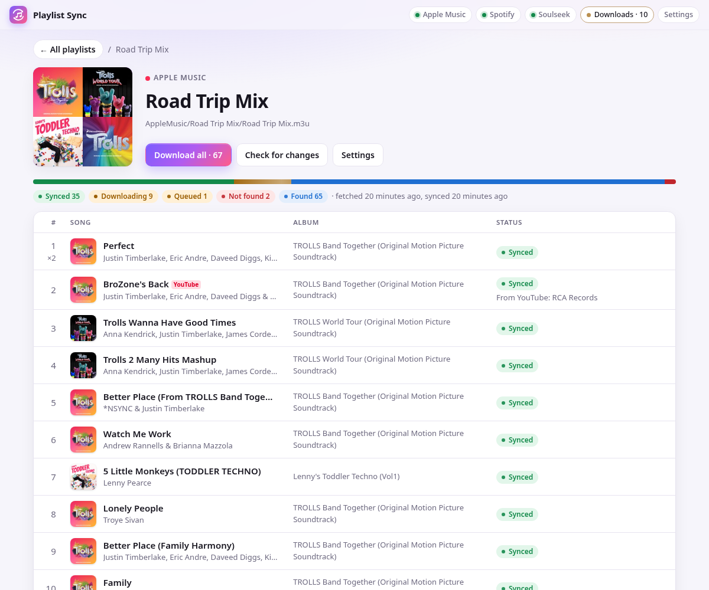
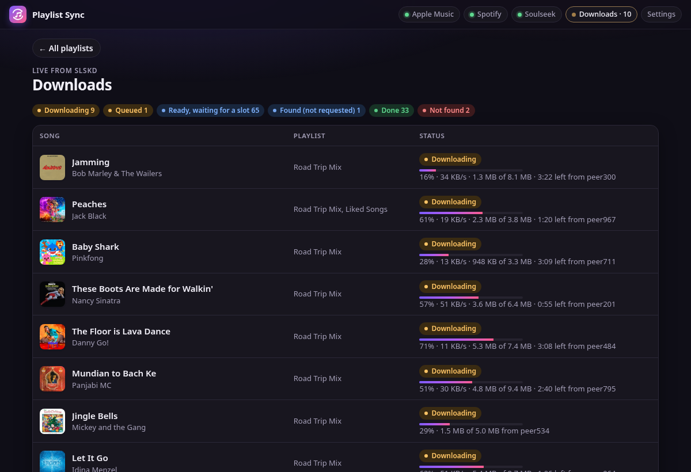

# soulseek-playlist-sync

Keep local MP3 copies of your Apple Music and Spotify playlists. Pick a playlist, and soulseek-playlist-sync gives it its own folder of tagged MP3s plus an `.m3u`, ready to copy onto an MP3 player or to play in Navidrome, Jellyfin, or Plex. Songs you already own are copied from your library; missing songs are downloaded one by one from Soulseek through [slskd](https://github.com/slskd/slskd), with an optional YouTube fallback for songs Soulseek doesn't have. Self-hosted, runs in Docker, and works without an Apple Developer account.



## Features

- **Apple Music and Spotify playlists**, including Apple collaborative playlists, Apple Favorite Songs, and Spotify Liked Songs.
- **One folder per playlist**, with numbered files (`001 - Artist - Title.mp3`) and a relative-path `.m3u`, so the folder works when you copy it to a phone, an SD card, or an MP3 player. File names are safe for FAT32 and exFAT.
- **Per-song sync status**: synced, in your library, downloading (with speed and time left), not found, removed from the playlist, and so on.
- **Reuses what you have.** Songs already in your library are matched by ISRC or by artist, title, and length, and hardlinked into the playlist folder instead of downloaded again.
- **Careful downloads.** MP3 only, 192 kbps or better (320 preferred), and the length has to match the streaming service's within 3 seconds, so you don't get live versions or the wrong edit.
- **Clean tags.** Every file is retagged from the streaming service: title, artist, album, album artist, track number, year, ISRC, and cover art (ID3v2.3, which every player reads).
- **YouTube fallback (optional).** For songs Soulseek doesn't have, it prefers official "Artist - Topic" audio uploads and skips covers, live takes, and sped-up edits.
- **Download all** button per playlist, live progress from slskd, and a Downloads page for everything in flight.
- Settings page, light and dark themes, works on phones, and installs to a phone's home screen.





## Prerequisites

You need the following:

| What | Needed for | Cost |
|---|---|---|
| A computer that runs Docker with Docker Compose (Linux server, NAS, Mac, or Windows with Docker Desktop) | Everything | Free |
| Disk space for the MP3s | Everything | About 8 to 10 MB per song |
| A Soulseek username and password | Downloading songs | Free. Pick any username: slskd creates the account the first time it logs in. |
| An Apple Music subscription | Apple Music playlists | Your existing subscription |
| An Apple Developer Program membership | Apple Music, **only if you want** the official sign-in | 99 USD a year. Not needed: see [Connect Apple Music](#connect-apple-music). |
| Spotify Premium and a free Spotify developer app | Spotify playlists | Your existing subscription. Spotify only lets Premium accounts use developer apps. |

You don't need both Apple Music and Spotify. Use either one, or both.

## Quick start

1. Clone the repository and create the folders the containers use:

   ```sh
   git clone https://github.com/averagenative/soulseek-playlist-sync.git
   cd soulseek-playlist-sync
   mkdir -p music data secrets slskd
   cp .env.example .env
   ```

   Create the folders before you start the containers. If Docker creates them, they belong to `root` and the app can't write to them.

1. Edit `.env`. At minimum, set these values:

   - `SOULSEEK_USERNAME` and `SOULSEEK_PASSWORD`: any username and password you want for Soulseek.
   - `SLSKD_WEB_PASSWORD`: a password for slskd's own web page.
   - `SLSKD_API_KEY`: a random string. To make one, run `openssl rand -hex 32`.
   - `MUSIC_DIR`: the folder where your music is, or leave `./music`.
   - `PUID` and `PGID`: the user and group that own that folder. To see yours, run `id`.

1. Start it:

   ```sh
   docker compose up -d
   ```

   The first build takes a few minutes.

1. Open `http://localhost:8080`, or `http://<server IP>:8080` from another device on your network.

1. Connect Apple Music, Spotify, or both, as described in the following sections.

1. Click **+ Apple Music** or **+ Spotify**, add a playlist, and click **Download all**.

The **Soulseek** status dot in the header turns green when slskd is logged in. Soulseek is a sharing network: the included setup shares your music folder read-only, because the network bans accounts that share nothing.

## Connect Apple Music

There are two ways to connect. Both read the same playlists.

### Option A: No Apple Developer account

This is the default. The app uses the same access that Apple's music.apple.com web player uses, and you sign in once by copying a cookie from your browser.

1. Leave `APPLE_TEAM_ID` and `APPLE_KEY_ID` empty in `.env`.
1. In the app, click **Connect Apple Music**.
1. On a computer, open [music.apple.com](https://music.apple.com) and sign in.
1. Open the browser's developer tools (F12, or Cmd+Option+I on a Mac).
   - Chrome or Edge: **Application** tab, then **Cookies**, then `https://music.apple.com`.
   - Firefox or Safari: **Storage** tab, then **Cookies**.
1. Copy the value of the `media-user-token` cookie and paste it into the app. The app checks it with Apple before saving it.

The cookie lasts a few months. When it expires, the app says so; paste a fresh one.

### Option B: With an Apple Developer account

If you have an Apple Developer Program membership, you can use your own MusicKit key and sign in with a normal Apple sign-in window.

1. Create a Media ID at [Certificates, Identifiers & Profiles > Identifiers](https://developer.apple.com/account/resources/identifiers/list/media): click **+**, choose **Media IDs**, enter a description and an identifier such as `media.com.example.playlistsync`, and select **MusicKit**.
1. Create a key at [Keys](https://developer.apple.com/account/resources/authkeys/list): click **+**, select **Media Services (MusicKit, ShazamKit)**, click **Configure**, and choose the Media ID from the previous step.
1. Download the `.p8` key file (Apple lets you download it only once) and save it as `secrets/AuthKey.p8`.
1. In `.env`, set `APPLE_KEY_ID` to the key's 10-character ID and `APPLE_TEAM_ID` to your Team ID from [Membership details](https://developer.apple.com/account).
1. Run `docker compose up -d`, then click **Connect Apple Music** in the app and sign in.

Apple's sign-in window needs the app to be open at `http://localhost:8080` or at an HTTPS address. Each person who runs the app needs their own key: never share your `.p8` file.

## Connect Spotify

1. Go to the [Spotify developer dashboard](https://developer.spotify.com/dashboard) and click **Create app**.
1. Fill in a name and description. For **Redirect URIs**, enter the address shown on the app's **Settings** page and click **Add**. For a default setup, it's `http://127.0.0.1:8080/spotify/callback`.
1. Select **Web API** and save.
1. Copy the app's **Client ID** (you don't need the client secret) and paste it on the app's **Settings** page, or set `SPOTIFY_CLIENT_ID` in `.env`.
1. Click **Connect Spotify** and approve.

Spotify accepts only HTTPS redirect addresses or `127.0.0.1`. If the app runs on another machine and you don't use HTTPS, connect through an SSH tunnel once:

```sh
ssh -L 8080:127.0.0.1:8080 you@your-server
```

Then open `http://127.0.0.1:8080` on your own computer and click **Connect Spotify**. After that, use the app from any address.

Spotify only lets apps read playlists you own or collaborate on, plus Liked Songs. Playlists you only follow are listed but can't be added. If Spotify returns a 403 error, add your account under **User Management** in your Spotify app's dashboard page.

## How syncing works

When you click **Download all**, the app does the following for each song in the playlist:

1. It looks for the song in your music folder (by ISRC, or by artist, title, and length). If it finds the song, it hardlinks it into the playlist folder, or copies it if the playlist folder is on another disk.
1. If the song isn't in your library, it searches Soulseek and downloads the best MP3: 320 kbps first, from a peer with a free slot, with the right length.
1. If Soulseek has no match and the YouTube fallback is on, it tries YouTube.
1. It retags the file from the streaming service's data and puts it in the playlist folder.
1. It writes the `.m3u` in the playlist's order.



Run **Download all** again whenever the playlist changes. New songs are added, reordered songs are renumbered, and songs removed from the playlist are marked **Removed upstream** and kept until you click **Prune removed**. The app only ever deletes files it created.

The result looks like this:

```
music/
  AppleMusic/
    Road Trip Mix/
      Road Trip Mix.m3u
      001 - Justin Timberlake - CAN'T STOP THE FEELING!.mp3
      002 - Jack Black - Peaches.mp3
  SpotifyMusic/
    Liked Songs/
```

Media servers that scan your music folder (Navidrome, Jellyfin, Plex) pick up the folders and the `.m3u` playlists. A song that's in your library and in a playlist folder shows up twice in them.

## Settings

Most settings are on the app's **Settings** page and apply right away: output folder names, numbering, how songs from your library are handled, minimum bitrate, length tolerance, downloads at once, the YouTube fallback, and the Spotify Client ID. Each playlist also has its own settings, including its folder; changing the folder moves the files.

The following environment variables configure things that can't change while the app runs:

| Variable | Default | Description |
|---|---|---|
| `MUSIC_ROOT` | `/music` | Music folder inside the container. Playlists go in `AppleMusic/` and `SpotifyMusic/` under it. |
| `LIBRARY_DIRS` | `MUSIC_ROOT` | Comma-separated folders to look in for songs you already own. |
| `DATA_DIR` | `/data` | Database and sign-in tokens. |
| `SLSKD_URL` | `http://slskd:5030` | slskd's address. |
| `SLSKD_API_KEY` or `SLSKD_API_KEY_FILE` | none | slskd API key. |
| `SLSKD_DOWNLOADS` | `/slskd-downloads` | slskd's finished-downloads folder, as mounted in this container. |
| `APPLE_MODE` | `auto` | `developer` (MusicKit key), `web` (no developer account), or `auto` (developer if a key is set up). |
| `APPLE_TEAM_ID`, `APPLE_KEY_ID`, `APPLE_KEY_FILE` | none | MusicKit key, for Apple option B. |
| `SPOTIFY_CLIENT_ID` | none | Spotify app Client ID. |
| `SPOTIFY_REDIRECT_URI` | worked out from the address you open | Set it if the app is behind a proxy that hides its public address. |
| `YOUTUBE_FALLBACK` | `0` | `1` to try YouTube for songs Soulseek doesn't have. |
| `APP_PASSWORD` | none | Asks for a password (HTTP basic auth) before showing the app. |
| `SLSKD_CONTROL` | `none` | `docker` or `webhook` adds a **Turn on** button for a stopped slskd. `docker` needs `/var/run/docker.sock` mounted and `SLSKD_CONTAINERS` (container names, in start order); `webhook` needs `SLSKD_CONTROL_URL`. |

## Use an slskd you already run

If you already run slskd (for example, with Lidarr and soularr), run only the `playlist-sync` service and point it at your slskd:

1. Add an API key to your slskd configuration with the `readwrite` role, limited to your Docker network:

   ```yaml
   web:
     authentication:
       api_keys:
         playlistsync:
           key: <a random string of 16 or more characters>
           role: readwrite
           cidr: 172.16.0.0/12
   ```

1. Set `SLSKD_URL` to your slskd's address and `SLSKD_API_KEY` to that key.
1. Mount slskd's finished-downloads folder at `/slskd-downloads`.

The app moves each finished download out of slskd's folder right away, so other tools that watch the same folder don't pick up its files.

## Run Soulseek through a VPN

`docker-compose.vpn.yml` routes slskd's Soulseek traffic through a VPN with [gluetun](https://github.com/qdm12/gluetun). The playlist app and its downloads from Apple, Spotify, and YouTube don't use the VPN.

1. In `.env`, set `VPN_USER` and `VPN_PASSWORD`. The defaults are for Private Internet Access (PIA) in a region with port forwarding (`CA Montreal`).
1. Start both files together:

   ```sh
   mkdir -p gluetun
   docker compose -f docker-compose.yml -f docker-compose.vpn.yml up -d
   ```

1. Run `docker compose logs gluetun` and look for `Initialization Sequence Completed`. The **Soulseek** dot in the app turns green after slskd logs in.

Use the same two `-f` options for every later `docker compose` command, such as `logs`, `pull`, and `down`.

The VPN setup does the following:

- It asks PIA for a forwarded port and gives it to slskd, so other Soulseek users can connect to you. This gets you more search results and faster downloads.
- It refreshes gluetun's list of VPN servers every day. Providers move servers, and a stale list means the VPN never connects.
- It uses UDP port 1198 with PIA's "normal" encryption preset, because the default preset can stall large transfers.

For another provider, set `VPN_SERVICE_PROVIDER` and the settings that provider needs from the [gluetun provider guides](https://github.com/qdm12/gluetun-wiki/tree/main/setup/providers), and remove the two PIA lines in `docker-compose.vpn.yml`.

## Update

```sh
git pull
docker compose build --pull --no-cache playlist-sync
docker compose up -d
```

Rebuilding with `--no-cache` also updates yt-dlp, which needs updates whenever YouTube changes.

## Troubleshooting

- **The header says "Soulseek offline."** slskd is running but isn't logged in to Soulseek. Check `docker compose logs slskd`. If you use a VPN, check that it's connected.
- **Apple Music asks you to reconnect.** Your sign-in expired. With option A, paste a fresh `media-user-token`.
- **A song stays "Not found."** Soulseek has no MP3 with the right length. Turn on the YouTube fallback, or click **Skip**. Every **Download all** tries not-found songs again.
- **Permission denied writing to the music folder.** Set `PUID` and `PGID` in `.env` to the owner of your music folder, and run `docker compose up -d` again.
- **Downloads are slow.** Each Soulseek peer has its own upload speed. Raise **Downloads at once** on the Settings page to download from more peers in parallel.

## A note on use

This tool is for keeping personal copies of music you have access to. Soulseek is a peer-to-peer network, and downloading from YouTube is against YouTube's terms of service; the YouTube fallback is off unless you turn it on. Check what's legal where you live.

The Apple option A sign-in uses Apple's web player access, which Apple doesn't document for other apps and can change without notice.

## Development

```sh
python3 -m venv .venv
.venv/bin/pip install -r requirements-dev.txt -r requirements-youtube.txt
.venv/bin/python -m pytest -q
DATA_DIR=./data MUSIC_ROOT=./music SLSKD_URL=http://localhost:5030 .venv/bin/uvicorn app.web:app --reload
```

The design is described in [docs/design.md](docs/design.md).

## License

[MIT](LICENSE)
